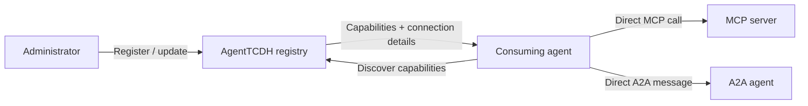

# AgentTCDH

**One registry for MCP servers and A2A agents.**

[](https://github.com/jiind/agent-tcdh/actions/workflows/ci.yml)
[](LICENSE)

Agent & Tool Capability Discovery Hub is an open-source TypeScript service for managing agent and tool connection metadata in one place. Register a target once, let consumers discover its capabilities and connection details, and execute directly against the selected target.

[Quickstart](#quickstart) · [Connect an agent](#mcp-discovery) · [Reference](docs/reference.md) · [Verification](#verified-behavior) · [Contributing](CONTRIBUTING.md)

## Why AgentTCDH

Keep shared target registrations in one place as agents and tools change. Consumers query the same registry, so additions, updates, and removals become visible on their next lookup.

- **One catalog:** remote MCP servers, local stdio MCP commands, and A2A agent endpoints.
- **Three discovery interfaces:** MCP tools, A2A messages, and an HTTP API over the same registry.
- **Direct execution:** consumers use returned connection details to call their selected tools or agent peers.
- **Persistent management:** SQLite storage, CLI administration, metadata import/refresh, conditional updates, and JSON backups.

## How it works



The consumer owns target selection, protocol clients, credentials, and execution permissions. The hub returns metadata; target connections and calls happen in the consumer's environment. Native tool mounting depends on the client. The registry searches keywords and filters; planning happens in the consuming agent.

## Quickstart

Use **Node.js 24 or newer** and npm. Install the published release:

```sh
npm install --global agent-tcdh@0.1.2
agent-tcdh init
agent-tcdh serve
```

For a hub without global installation:

```sh
npx --yes agent-tcdh@0.1.2 serve
```

To run the isolated demo from source:

```sh
git clone https://github.com/jiind/agent-tcdh.git
cd agent-tcdh
npm ci
npm run demo
```

The [v0.1.2 GitHub release](https://github.com/jiind/agent-tcdh/releases/tag/v0.1.2) provides the built tarball, source manifest, and checksums. See the [release notes](docs/releases/v0.1.2.md) for features and verification scope. Source commands below use the repository checkout; an installed CLI uses `agent-tcdh` in place of `npm run cli --` or `node dist/index.js`.

The demo starts an isolated hub, registers three local targets, discovers them, and calls HTTP MCP, stdio MCP, and A2A targets directly. It checks execution receipts and cleans up. No account, API key, external service, or model is needed.

```sh
npm run demo -- --discovery a2a
npm run demo -- --serve
```

`--discovery a2a` queries the hub over A2A. `--serve` keeps the demo available for manual connections. See [the local demo guide](docs/local-demo.md).

### Start a persistent registry

```sh
npm run build
npm start
```

The hub listens at `http://127.0.0.1:3000`. In another terminal, import the supplied public documentation registrations:

```sh
npm run cli -- registry import examples/public-docs-registry.json
npm run cli -- target list --tag public-docs
npm run cli -- target list --q OpenAI --protocol mcp
npm run cli -- target get openai-docs
```

The snapshot includes OpenAI Docs, Toss Payments Docs, Microsoft Learn, Cloudflare Docs, Context7, and DeepWiki. Import stores their observed metadata. Consumers establish connections when using a target; Toss's pinned npm command runs in the consumer environment.

These are working examples, not a provider allowlist. Register other MCP servers and A2A agents using the [generic definition schema](docs/reference.md#search-and-connection-definitions), or [import their remote metadata](docs/reference.md#import-and-refresh-metadata).

## Guided setup in v0.1.2

Version `0.1.2` adds guided setup, file-free registration, seven connection profiles, configuration import, presets, diagnostics, target editing, and registry comparison. Use the published `0.1.2` package or this source checkout; earlier `0.1.1` installations do not include these commands.

```sh
npm run build
node dist/index.js init
node dist/index.js serve
```

In another terminal in the checkout, replace the example URL with your target:

```sh
node dist/index.js target add https://mcp.example.com/mcp
node dist/index.js connect codex --print
node dist/index.js connect claude-code --print
node dist/index.js connect gemini-cli --print
node dist/index.js doctor
```

`init` saves reusable settings. Quick add inspects remote metadata or records a local stdio command. `connect` generates Codex, version-specific OpenCode, Claude Code, Gemini CLI, Cursor, or VS Code settings; explicit file writes merge and back up existing configuration. `doctor` separates hub access, metadata checks, and unverified execution. See [guided setup and diagnostics](docs/onboarding.md) for credential references, non-interactive setup, and merging options. The [additional client guide](docs/client-connections.md) explains stdio bridge profiles and their verification scope.

Bring existing MCP settings into the shared registry or select bundled documentation targets:

```sh
node dist/index.js registry import-config /path/to/config.toml --select docs
node dist/index.js registry import-config /path/to/config.toml --select docs --compare --on-conflict skip
node dist/index.js registry import-config /path/to/config.toml --select docs --apply
node dist/index.js preset list
node dist/index.js preset import public-docs --select openai-docs --apply
node dist/index.js doctor --all --tag imported-config
node dist/index.js target edit openai-docs --add-tag team-docs --dry-run
node dist/index.js target disable openai-docs --dry-run
```

Configuration imports and presets default to offline previews; `--apply` registers the selected connections atomically. Import preserves the source file, replaces known inline environment/Bearer values with variable references, and reports unsupported settings. Review literal command arguments before applying. `doctor --all` explicitly inspects matching registrations with bounded concurrency and per-target results; it fetches remote metadata without executing tools/tasks. See [configuration import and presets](docs/config-import.md) for formats, conflicts, and consumer-side credentials.

Edit labels/tags or enable/disable registrations without rewriting JSON files. Use `--dry-run` to review changes; new edit/state commands save against the observed registration version. See [target management](docs/target-management.md) for conflict handling and deletion previews.

Use `registry diff snapshot.json` or an import preview with `--compare` to review added, changed, unchanged, and retained definitions against the hub. Comparison is read-only; see [registry comparison](docs/registry-comparison.md) for conflict policies and consistency limits.

## Unreleased improvements

Source checkouts include these additions, which are not in the published `0.1.2` package:

- `connect --check FILE` compares a saved profile with the expected hub address, credential references, and bridge paths. See [connection checks](docs/connection-check.md).
- `disconnect CLIENT --file FILE` previews named-entry removal; `--apply` writes it with an exact backup. See [client disconnection](docs/client-disconnection.md).
- `config restore BACKUP_FILE --file FILE` previews whole-file recovery; `--apply` restores it and backs up the current file. See [configuration restoration](docs/configuration-restore.md).

## MCP discovery

Connect your MCP client to `http://127.0.0.1:3000/mcp`.

| Tool | Purpose |
| --- | --- |
| `search_targets` | Search capabilities; filter by keyword, protocol, or tag; paginate results |
| `get_target` | Retrieve current capabilities, transport, address/command, and credential references |

Configure the hub once in your consumer, then ask it to discover suitable targets and connect directly. For example:

> Find the official OpenAI documentation server in AgentTCDH. Retrieve its connection details and use its documentation search tool directly to answer my question.

The consumer needs permission and a way to call the discovered target. Recorded Codex runs used native MCP discovery and agent-written HTTP clients for execution. See [Codex/OpenCode configuration and stdio setup](docs/reference.md#mcp-discovery) and [actual-agent verification](docs/agent-verification.md).

## A2A discovery

Agent peers can discover the hub through `/.well-known/agent-card.json` and query it through `/a2a`. The hub supports A2A 1.0 and 0.3 JSONRPC discovery with structured `search_targets` and `get_target` operations.

The selected target's protocol determines how the consumer executes it. A consumer can discover an MCP server through the hub's A2A interface, then call that server with MCP. See [message formats and protocol versions](docs/reference.md#a2a-discovery).

## Manage registrations

```sh
npm run cli -- target import https://mcp.example.com/mcp --id docs --protocol mcp --dry-run
npm run cli -- target import https://agent.example.com --id researcher --protocol a2a --dry-run
npm run cli -- target refresh openai-docs --dry-run
npm run cli -- target check openai-docs
npm run cli -- registry export backups/registry.json
```

Replace example addresses with your own endpoints. Import/refresh inspect metadata. `target check` compares the registration with current remote metadata and reports drift; it does not verify execution. Stdio commands can be registered as JSON without launching them during registration.

The [reference](docs/reference.md) covers CRUD, disabling targets, search, authentication references, ETag concurrency protection, snapshots, and all CLI commands. The running hub exposes its OpenAPI specification at `/openapi.json`.

## Storage, authentication, and deployment

The default SQLite registry lives at `~/.agent-tcdh/registry.sqlite`, using the current user's home directory on each OS.

| Setting | Purpose |
| --- | --- |
| `HOST`, `PORT` | Listener address; defaults to `127.0.0.1:3000` |
| `AGENT_TCDH_DB_PATH` | Registry database location |
| `AGENT_TCDH_TOKEN` | Administrator Bearer token |
| `AGENT_TCDH_READ_TOKEN` | Separate read-only discovery token; requires an administrator token |
| `AGENT_TCDH_PUBLIC_URL` | Consumer-facing URL advertised in the A2A card |

Use administrator credentials for registration changes and read credentials for discovery. Store provider credential references in registrations and resolve them in the consuming environment. With no hub tokens configured, the hub accepts anonymous requests.

For Docker, copy `.env.example` to `.env`, then run:

```sh
docker compose up --build -d
```

Compose uses a non-root Linux container and a persistent registry volume. Local npm execution reads shell environment variables; Compose reads `.env`. See [deployment, token roles, origins, and reverse proxies](docs/reference.md#storage-authentication-and-deployment).

## Verified behavior

Recorded verification on 2026-10-27:

| Scope | Observed result | Evidence |
| --- | --- | --- |
| Native platforms | Linux x64, macOS Apple Silicon/Intel, and Windows x64 passed regression and isolated package checks | [Platform report](docs/platform-compatibility.md) |
| Public MCP services | Actual documentation calls succeeded for all six supplied providers through both hub discovery interfaces | [Public MCP report](docs/public-mcp-verification.md) |
| Agent selection | Codex selected and executed 3 and 5 relevant MCP/A2A targets from 10 local candidates, with no unrelated execution attempts | [Selection report](docs/selection-verification.md) |
| Model-backed targets | Gemini CLI through an A2A test adapter and official TypeSafe Jev through an MCP test adapter each returned a real response | [Model-target report](docs/model-target-verification.md) |

Local fixtures, SDK-driven provider calls, actual model selection, and model-backed adapters are separate checks. The reports preserve their execution paths, failures, fixes, and limits. They do not establish automatic dynamic tool mounting or compatibility with every commercial agent.

### Run checks

```sh
npm run check
npm run test:package
```

CI runs typecheck, regression, and package checks on all four native OS/architecture combinations, plus independent Linux container verification. See [platform and shell-specific setup](docs/platform-compatibility.md).

Public MCP verification is opt-in:

```sh
npm run test:public-mcp
```

Real-agent/model checks are also opt-in and can consume model usage. See [verification commands](docs/reference.md#verification). The default suite and CI use local fixtures.

## Documentation

- [CLI, API, protocols, and configuration reference](docs/reference.md)
- [Guided setup, agent configuration, and diagnostics](docs/onboarding.md)
- [Local demo](docs/local-demo.md)
- [MCP/A2A agent registration compatibility](docs/agent-compatibility.md)
- [Actual-agent verification](docs/agent-verification.md)
- [v0.1.2 release notes](docs/releases/v0.1.2.md), [changelog](CHANGELOG.md), and [release process](docs/releasing.md)
- [Contributing](CONTRIBUTING.md) and [security policy](SECURITY.md)

Project documentation, comments, and application messages use English. Original provider metadata and intentional Unicode fixtures retain their original text.

## License

[Apache-2.0](LICENSE)
